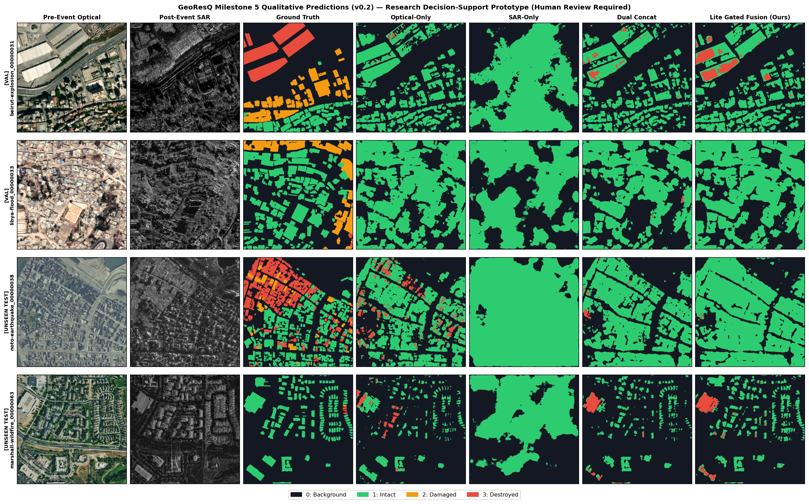
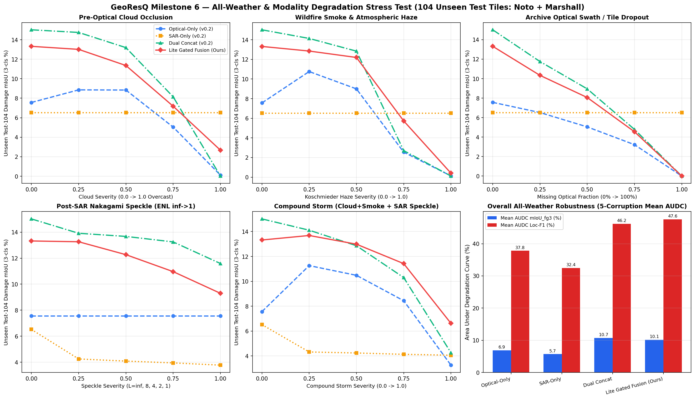
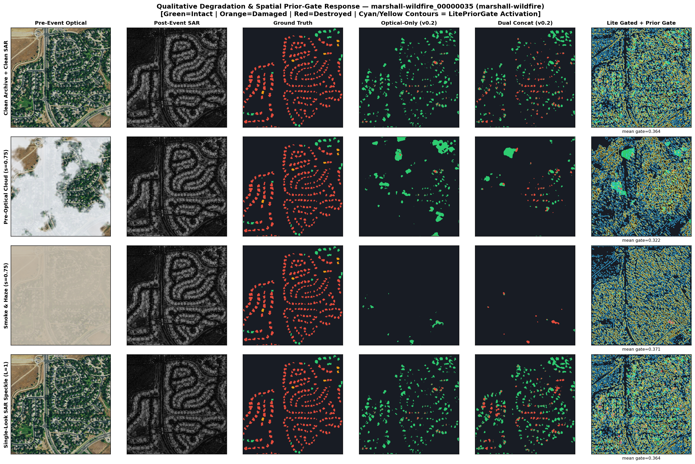
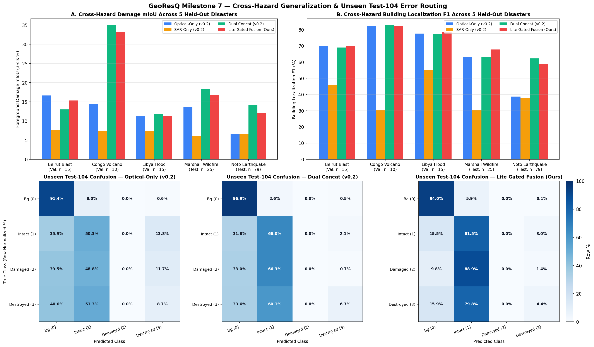
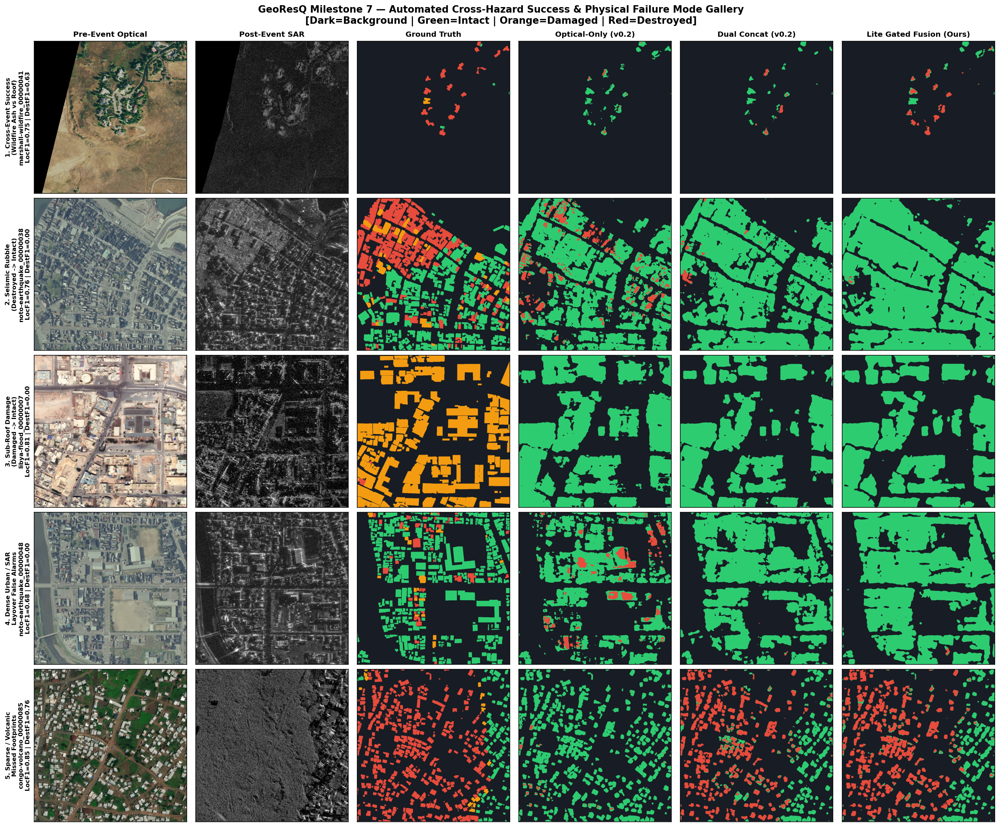

# GeoResQ: All-Weather Multimodal Optical–SAR Building Damage Assessment & Stress-Testing Suite

[](LICENSE)
[](pyproject.toml)
[](https://doi.org/10.5194/essd-17-6217-2025)

> **Responsible-AI Notice:** GeoResQ is an **academic remote-sensing research framework and human-in-the-loop triage prototype**. Outputs must **never** be used for autonomous emergency dispatch, financial/insurance adjudication, or conflict targeting without verification by qualified human imagery analysts. See [`docs/MODEL_CARD.md`](docs/MODEL_CARD.md).

---

## 1. Research Motivation

During the critical first 24–72 hours after earthquakes, volcanic eruptions, floods, or wildfires, **post-disaster optical satellite imagery is frequently unavailable or unusable** due to storm clouds, wildfire smoke plumes, volcanic ash, or nighttime overpass timing. Conversely, **Synthetic Aperture Radar (SAR)** penetrates clouds, smoke, and darkness, while **archived pre-disaster Very-High-Resolution (VHR) optical imagery** provides crisp rooftop geometry and urban context.

**GeoResQ** investigates asymmetric **Pre-Event Optical RGB + Post-Event VHR X-Band SAR** semantic segmentation for 4-class building damage assessment (`0: Background`, `1: Intact`, `2: Damaged`, `3: Destroyed`) on the open-license events of the **BRIGHT** benchmark (*Chen et al., ESSD 2025*), asking three empirical questions:
1. **Multimodal Synergy & Architecture:** How much do dual-stream optical–SAR architectures improve zero-shot cross-disaster generalization over unimodal baselines, and how can cross-modal gating avoid small-sample over-parameterization?
2. **All-Weather & Sensor Degradation Robustness:** How gracefully do unimodal, naive concatenation (`Dual Concat`), and spatially gated (`Lite Gated Fusion`) models degrade under cloud occlusion, Koschmieder smoke/haze, archive swath dropout, Nakagami-$L$ SAR speckle, and compound storm conditions?
3. **Cross-Hazard Physics & Failure Taxonomy:** Across 5 held-out disaster mechanisms (port blast, basaltic lava inundation, flash flood, suburban wildfire, and M7.6 seismic timber collapse), which physical damage signatures are observable from overhead Optical–SAR fusion and which remain fundamentally ambiguous?

---

## 2. Architecture & Diagnostic Evolution (`v0.1` $\rightarrow$ `v0.2`)

### From Milestone 4 Negative Diagnosis (`v0.1`, 45 Tiles) to `LitePriorGatedFusion` (`v0.2`, 294 Tiles)
In our controlled Milestone 4 study (`results/metrics/ablation_v0_1_table.csv`), two critical failure modes emerged:
- **Dense Fusion Over-Parameterization:** Full-channel `3×3` cross-modal fusion blocks (`39.77M` params vs. `26.29M` `Dual Concat`) overfit at `epoch = 2` on small training splits, collapsing to `0.0115` unseen foreground mIoU on `noto-earthquake`.
- **Rooftop Merging from Stride-2 Stem & Aggressive Class Weights:** Down-weighting background (`power = 0.35`, $w_{\text{bg}} = 0.30$ vs. $w_{\text{dest}} = 1.73$) without a `1×` skip flooded narrow `2–4 px` alleys with false-positive building predictions (`49.8%` background recall).

**GeoResQ `v0.2` (`src/georesq/models/fusion.py`)** resolves both bottlenecks with minimal parameter overhead (`26.78M` vs. `26.32M` `Dual Concat`, **`+1.7%` params**):
1. **`LitePriorGatedFusionBlock` at all 5 ResNet-18 Pyramid Scales (`1/2` $\rightarrow$ `1/32`):**
   - Projects optical and SAR features $(F_l^{\text{opt}}, F_l^{\text{sar}}) \in \mathbb{R}^{C_l \times H_l \times W_l}$ through `1×1` bottlenecks ($M_l = \max(32, C_l/4)$) to $(o_m, s_m)$.
   - Computes a spatial sigmoid optical building-prior gate $g_l = \sigma(\text{Conv}_{3\times3}(o_m)) \in [0, 1]^{1 \times H_l \times W_l}$ to modulate post-SAR backscatter ($g_l \odot s_m$) alongside cross-modal discrepancy $|o_m - s_m|$.
   - Applies a `3×3` depthwise-separable change branch + Squeeze-and-Excitation + learnable **LayerScale** residual ($\gamma_0 = 0.05$) anchored on a `1×1` concatenation projection:
     $$F_l^{\text{fused}} = \text{ReLU}\!\Big(\text{BN}(\text{Conv}_{1\times1}([F_l^{\text{opt}}; F_l^{\text{sar}}])) + \gamma_l \cdot \text{SE}\big(\Phi_{\text{dw}}([g_l \odot s_m;\; |o_m - s_m|])\big)\Big)$$
2. **Full-Resolution `1×` (`32`-ch) Boundary Skip Stem:** Preserves sharp `0.30–0.50 m` street canyons and individual roof edges prior to stride-2 encoder pooling.
3. **Tempered Combo + Auxiliary Localization Objective:** Combines class-weighted Cross-Entropy (`power = 0.15`) + `0.75 × Lovasz-Softmax` with `0.5 × BuildingLocBCEDiceLoss` on binary building footprints.



---

## 3. Verified Experimental Results (`BRIGHT v0.2` — 294 Open Tiles Across 11 Disasters)

All splits enforce **strict zero disaster-event overlap** (`seed = 42`, `0` spatial alignment mismatches):
- **Train (`150` tiles, 6 events):** `turkey-earthquake` (35), `morocco-earthquake` (30), `la_palma-volcano` (25), `bata-explosion` (20), `haiti-earthquake` (20), `hawaii-wildfire` (20).
- **Validation (`40` tiles, 3 events):** `beirut-explosion` (15), `libya-flood` (15), `congo-volcano` (10).
- **Unseen Test (`104` tiles, 2 events):** `noto-earthquake` (79 — 100% of event) and `marshall-wildfire` (25).

### 3.1 Milestone 5 — Controlled 4-Model Multi-Hazard Benchmark (`results/metrics/benchmark_v0_2_table.csv`)

| Model (`v0.2`, 22 ep, T4 AMP) | Params | Val Bg Recall | Val Loc-F1 | Val `mIoU_fg3` | Val `Destroyed` F1 | Unseen `Test-104` Loc-F1 | Unseen `Test-104` `mIoU_fg3` | `Noto` (n=79) `mIoU_fg3` / Loc-F1 | `Marshall` (n=25) `mIoU_fg3` / Loc-F1 |
|---|---:|---:|---:|---:|---:|---:|---:|---:|---:|
| **Optical-Only (`v0.2`)** | 14.43M | 92.26% | 0.7468 | 0.1427 | 0.1247 | 0.4262 | 0.0756 | 0.0658 / 0.3877 | 0.1365 / 0.6292 |
| **SAR-Only (`v0.2`)** | 14.43M | 81.34% | 0.4801 | 0.0748 | 0.0000 | 0.3629 | 0.0652 | 0.0667 / 0.3806 | 0.0608 / 0.3066 |
| **Dual Concat (`v0.2`)** | 26.32M | **94.18%** | 0.7391 | 0.1857 | 0.3218 | **0.6259** | **0.1502** | **0.1409** / **0.6238** | **0.1839** / 0.6337 |
| **Lite Gated Fusion (Ours)** | 26.78M | 92.67% | **0.7487** | **0.1937** | **0.3563** | 0.6075 | 0.1332 | 0.1206 / 0.5908 | 0.1683 / **0.6787** |

- **Boundary & Localization Recovery:** Validation background recall rose from `49.8%` (`v0.1`) to **`92.3%–94.2%`**, while `Lite Gated Fusion` leads **every aggregate Validation metric** (`mIoU_fg3 = 0.1937`, `Macro-F1 = 0.2968`, `Loc-F1 = 0.7487`, `Destroyed F1 = 0.3563`) and unseen `marshall-wildfire` Localization F1 (`0.6787`, `+4.50` pts over `Dual Concat`).
- **Multimodal Gain on Unseen Geographies:** On `Test-104`, both dual-stream architectures achieve **`+76%` to `+99%` relative foreground damage mIoU** over `Optical-Only` (`0.0756`) and **`+104%` to `+130%`** over `SAR-Only` (`0.0652`). While `Dual Concat` achieves higher background precision on sparse rural `noto-earthquake` tiles (`3.14%` FP rate vs. `6.01%`), `Lite Gated Fusion` cuts **missed building false negatives in half** across `Test-104` (**`15.36%`** missed building pixels vs. `32.04%` for `Dual Concat` and `36.48%` for `Optical-Only`).

---

### 3.2 Milestone 6 — All-Weather & Sensor-Degradation Stress Test (`results/metrics/stress_test_v0_2_summary.json`)

All 4 frozen `v0.2` checkpoints were evaluated **without retraining** across 5 corruption severities (`s ∈ {0.00, 0.25, 0.50, 0.75, 1.00}`) on `Test-104`:

| Model | Cloud AUDC (`mIoU` / `Loc`) | Smoke & Haze `s=0.75` (`mIoU` / `Loc`) | SAR Speckle `L=1` (`mIoU` / `Loc`) | Compound Storm AUDC (`mIoU` / `Loc`) | 5-Corruption Mean AUDC (`mIoU` / `Loc`) |
|---|---:|---:|---:|---:|---:|
| **Optical-Only (`v0.2`)** | 6.64% / 35.68% | 2.55% / 18.16% | 7.57% / 42.63% | 8.90% / 46.26% | 6.86% / 37.80% |
| **SAR-Only (`v0.2`)** | 6.52% / 36.29% | **6.52%** / **36.29%** | 3.78% / 23.46% | 4.50% / 26.99% | 5.69% / 32.44% |
| **Dual Concat (`v0.2`)** | **10.90%** / 46.16% | 2.71% / 13.50% | **11.59%** / **59.18%** | 11.73% / 49.19% | **10.75%** / 46.21% |
| **Lite Gated Fusion (Ours)** | 9.89% / **47.07%** | 5.73% / 31.70% | 9.30% / 58.25% | **12.02%** / **51.46%** | 10.13% / **47.60%** |

- **Atmospheric Veil & Compound Storm Advantage of Spatial Gating:** Under heavy Koschmieder smoke/haze (`s = 0.75`), `Dual Concat` collapses to `2.71%` `mIoU_fg3` (`13.50%` `Loc-F1`), whereas **`Lite Gated Fusion` retains `2.11×` higher `mIoU_fg3` (`5.73%`) and `2.35×` higher `Loc-F1` (`31.70%`)**. Under **Compound Storm** (`Cloud + Smoke + SAR Speckle`), `Lite Gated Fusion` achieves the **#1 AUDC on both `mIoU_fg3` (`12.02%`) and `Loc-F1` (`51.46%`)**, retaining **`85.8%`** of clean `mIoU_fg3` at `s = 0.75` and **`+55.4%` higher `mIoU_fg3`** than `Dual Concat` at `s = 1.00`.
- **SAR Speckle Resilience:** Under single-look Rayleigh amplitude speckle (`ENL = 1`), `SAR-Only` drops `42%` (`0.0652 → 0.0378`), while anchoring SAR on clean pre-optical priors preserves `69.8%–77.2%` of `mIoU_fg3` (`Dual Concat = 0.1159`, `Lite Gated = 0.0930`).





---

### 3.3 Milestone 7 — Cross-Hazard Generalization & Physical Failure Analysis (`144` Held-Out Tiles)

Auditing all 5 held-out disaster events (`results/metrics/failure_analysis_v0_2_summary.json` & `per_tile_audit_v0_2.csv`) reveals a clear electromagnetic scattering taxonomy:
1. **Clean Backscatter Loss (Volcanic Lava & Wildfire Ash — High Recall):** Where buildings are buried by smooth basaltic lava (`congo-volcano`: `Destroyed F1 = 0.664–0.671`) or incinerated to bare foundations (`marshall-wildfire`: `Destroyed F1 = 0.145–0.240`, `Loc-F1 = 0.679`), X-band double-bounce reflections vanish relative to pre-optical roof priors, enabling sharp boundary-accurate damage mapping.
2. **Pancaked Ceramic Rubble (`noto-earthquake` — `Destroyed → Intact` Ambiguity):** Collapsed Japanese timber structures (`kawara` roof tiles pancaking onto their footprints) continue to scatter X-band radar strongly, causing `74.4%–94.1%` of `Destroyed` pixels in Noto to be predicted as `Intact`.
3. **Sub-Roof Facade & Flood Inundation (`Class 2: Damaged` Invisibility):** Across `libya-flood` and `beirut-explosion`, `Damaged` buildings retain intact roofs in nadir optical/SAR geometry (`65%–89%` routed to `Intact`), explaining near-zero Class-2 F1 (`0.73%` of train pixels).





---

## 4. Quickstart & Standalone Triage CLI (`Milestone 8`)

### Installation & Automated Test Suite
```bash
git clone https://github.com/Rakib-codee/GeoResQ.git
cd GeoResQ
pip install -e ".[gpu]"
python3 -m unittest discover -s tests -v
```

### Run Standalone Tile Inference & Uncertainty Triage (`georesq-predict`)
`scripts/predict_tile.py` runs paired GeoTIFF inference on `cuda`, Apple Silicon `mps`, or `cpu`, outputting `predicted_damage_mask.tif`, normalized Shannon entropy `uncertainty_entropy.png`, visual `triage_panel.png`, and sector-ranked `triage_report.json`:

```bash
# 1. Self-contained 256x256 synthetic smoke-test (<2s on MacBook M2 or CPU, no external data needed):
python3 scripts/predict_tile.py --demo-synthetic --output-dir outputs/demo_triage

# 2. Inference on a real paired GeoTIFF tile with compact ~51 MB fp16 checkpoint:
python3 scripts/predict_tile.py \
  --pre-optical path/to/tile_pre_disaster.tif \
  --post-sar path/to/tile_post_disaster.tif \
  --checkpoint exports/lite_gated_fusion_v0_2_fp16.pth \
  --output-dir outputs/tile_triage
```

---

## 5. Repository Structure

```text
GeoResQ/
├── configs/                  # Reproducible YAML configs (dataset, v0.1 ablation, v0.2 benchmark, M6 stress test)
├── docs/
│   ├── MODEL_CARD.md         # Disaggregated performance, failure modes & Responsible-AI guardrails
│   └── REPRODUCIBILITY.md    # Exact seeds, Cloud HTTP-206 subset builder, T4 VRAM & runtime specs
├── results/
│   ├── figures/              # Verified benchmark, stress-test, confusion-matrix & failure-gallery PNGs
│   └── metrics/              # Strict JSON/CSV manifests, band stats, per-tile audits & summaries
├── scripts/                  # Modular CLI entry points (subset builder, trainers, stress test, failure audit, predict)
├── src/georesq/
│   ├── cli/predict.py        # Standalone inference, Shannon entropy & sector triage engine
│   ├── data/dataset.py       # License-enforced BRIGHT GeoTIFF dataset & zero-leakage verifier
│   ├── evaluation/metrics.py # 4x4 DamageEvaluator & localization-vs-severity error decomposition
│   ├── models/               # BaselineUNet & DualStreamDamageNet (LitePriorGatedFusion + 1x skip)
│   ├── preprocessing/        # Modality-specific normalization & physically grounded sensor corruptions
│   └── training/             # Combo CE+Lovasz + BuildingLocBCEDice losses & AMP checkpoint engine
└── tests/                    # 19 unit tests covering transforms, models, corruptions, metrics & CLI
```

---

## 6. Citation & Acknowledgments

If you use GeoResQ or build upon its evaluation protocols, please cite the **BRIGHT** dataset paper alongside this repository:

```bibtex
@article{chen2025bright,
  title   = {BRIGHT: A globally distributed multimodal building damage assessment dataset with very-high-resolution for all-weather disaster response},
  author  = {Chen, Hongruixuan and Song, Jian and Dietrich, Olivier and Broni-Bediako, Clifford and Xuan, Weihao and Wang, Junjue and Shao, Xinlei and Wei, Yimin and Xia, Junshi and Lan, Cuiling and Schindler, Konrad and Yokoya, Naoto},
  journal = {Earth System Science Data},
  volume  = {17},
  pages   = {6217--6245},
  year    = {2025},
  doi     = {10.5194/essd-17-6217-2025}
}
```
